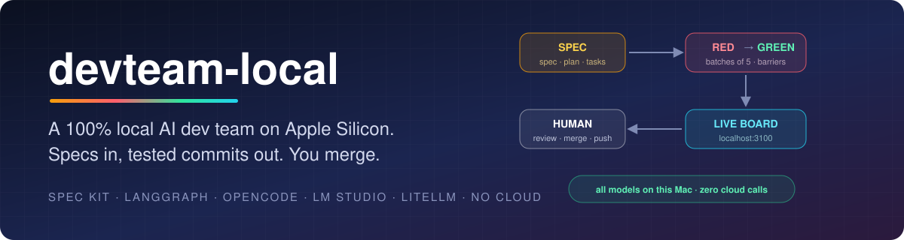
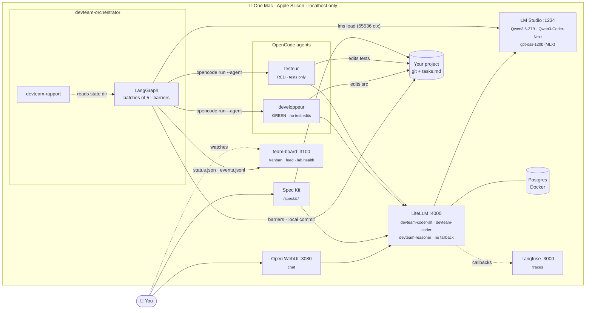
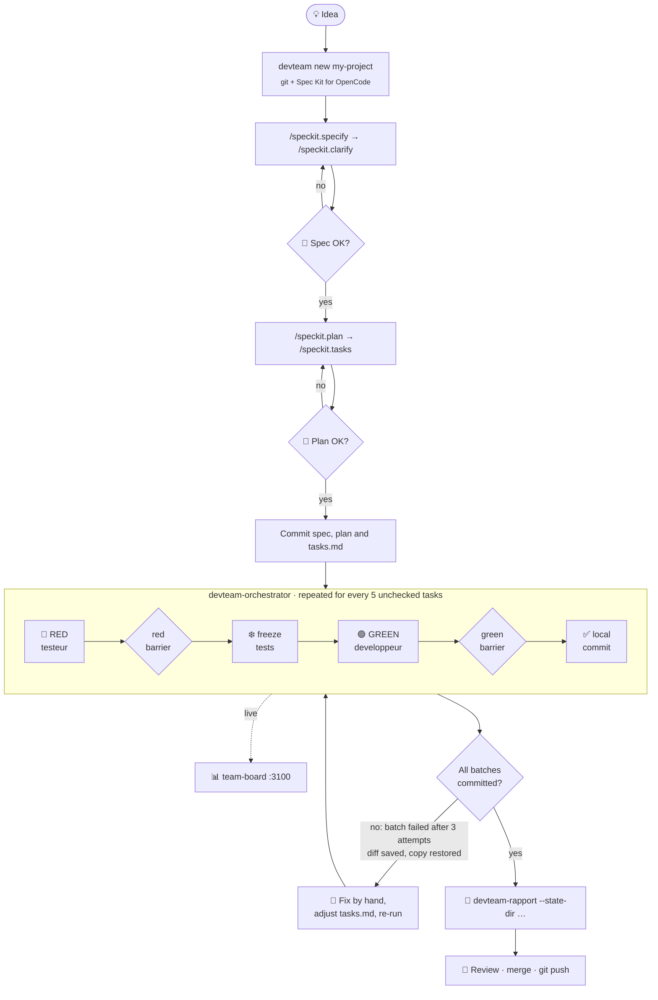

<p align="center">
  
</p>

<p align="center">
  
  
  
  
  
  
  
</p>

<p align="center">
  <b>A software team made of AI agents, running on open models on a single Mac.<br>
  You write the spec. The agents write the tests, then the code, in small checked batches.<br>
  You review, merge and push.</b>
</p>

---

## Contents

- [What it is](#what-it-is)
- [Principles](#principles)
- [Architecture](#architecture)
- [How a feature flows](#how-a-feature-flows)
- [The repositories](#the-repositories)
- [Get started](#get-started)
- [Your first project](#your-first-project)
- [Roadmap](#roadmap)
- [Contributing](#contributing)

## What it is

**devteam-local** is an experiment in fully agentic development, on new projects, **without the cloud**:

1. **Spec-driven:** a feature starts as a [Spec Kit](https://github.com/github/spec-kit) spec, then a plan, then a `tasks.md`, with a human approving each step.
2. **Orchestrated:** a LangGraph orchestrator takes the unchecked tasks **five at a time**, each batch in fresh OpenCode sessions, so the local models never drown in a long context.
3. **Test-first, enforced:** a *tester* agent (Qwen3.6-27B) writes failing tests (**RED**). A *developer* agent (Qwen3-Coder-Next) makes them pass (**GREEN**). Barriers written in code, not prompts, check every step before a **local** commit.
4. **Visible:** a live board on `localhost:3100` shows tasks moving, the activity feed and the health of the lab. `devteam-rapport` summarizes each run.
5. **Human-owned:** nothing is ever pushed or merged by an agent. You review, merge and push.

All models run in LM Studio (MLX) behind a LiteLLM gateway with role aliases. Langfuse traces every call.

## Principles

| | Principle | In practice |
|:-:|---|---|
| 🏠 | **Local only** | Models served by LM Studio on `:1234`; every tool talks to LiteLLM on `127.0.0.1:4000`. |
| 🚫☁️ | **No cloud fallback without a human** | LiteLLM has no fallback configured. Cloud escalation is planned only behind an explicit human approval (`devteam approve`, not built yet). |
| 🔴🟢 | **TDD by default** | `tdd` is the orchestrator's default mode: tests first, frozen by sha256, then code. |
| 👤 | **Human in the loop** | Humans approve spec and plan, decide after a failed batch, and own merges. |
| 🔒 | **Never auto-push** | One local commit per green batch. OpenCode permissions deny `git push`, `git commit`, `curl`, `ssh`, package installs, `*.env`… |

## Architecture



## How a feature flows



## The repositories

| | Repository | What it does | Stack |
|:-:|---|---|---|
| 🧰 | [**devteam-lab**](https://github.com/devteam-local/devteam-lab) | `devteam.sh` installs (and uninstalls, from a manifest) LM Studio or oMLX, the models, LiteLLM + Postgres, LangGraph, OpenCode, Spec Kit, Langfuse and Open WebUI, asking `[o/N]` before every step. Also versions the tuned configs (`opencode.json` with the agents, `litellm/config.yaml`). Lives in `~/agentic-development`. | zsh, Docker, launchd |
| 🧠 | [**devteam-orchestrator**](https://github.com/devteam-local/devteam-orchestrator) | Runs a Spec Kit `tasks.md` in batches of 5 with enforced TDD (tester RED, developer GREEN, barriers, 3 attempts per phase), commits locally, writes `status.json` / `events.jsonl`. `devteam-rapport` summarizes a run. | Python 3.12, LangGraph, pytest |
| 📊 | [**team-board**](https://github.com/devteam-local/team-board) | Live dashboard on `:3100`: six-column Kanban, activity feed over SSE, Langfuse links, agent workload, plus a system view (services, loaded models, alias activity, projects, memory). | Node 18+, Express, vanilla JS |

## Get started

> [!IMPORTANT]
> **The reproducible install is still in progress.** `devteam.sh` generates its own `litellm/config.yaml` and `opencode/opencode.json` **without** the tuned settings committed in devteam-lab (OpenCode agents `testeur` / `developpeur`, permission rules, `litellm/master.key`, LiteLLM `max_tokens: 8192` / `timeout: 900` per model). Some committed files also contain absolute paths from the author's machine (`/Users/cyril/...` in `config.env` and `projects.list`, and in a comment in `config.yaml`). **Until then:** follow the steps below. They let the installer write your own `config.env`, then put the committed configs back after the install, with `/Users/cyril` replaced by your `$HOME`.

### 1. Check your Mac

| | Minimum | Recommended |
|---|---|---|
| Chip | Apple Silicon (`arm64`) | M-series Max/Ultra |
| macOS | 14 (15+ for oMLX) | 26 (reference machine) |
| Unified memory | 64 GB (reduced model profile) | **128 GB** (full profile: gpt-oss-120b + Qwen3-Coder-Next + Qwen3.6-27B) |
| Disk | models + 20 % free (~125 GB for the full profile) | external SSD supported (`--models-dir`) |
| Free ports | 1234, 3000, 3080, 4000, 5432 (8000 for oMLX) | |
| Network | `huggingface.co`, `github.com` during the install | none afterwards |

> [!NOTE]
> The orchestrator's TDD defaults use **Qwen3.6-27B** (tester) and **Qwen3-Coder-Next** (developer). The installer only adds Qwen3-Coder-Next to the reduced profile when you have at least 96 GB.

### 2. Clone the three repositories

The tools assume these exact locations: the lab in `~/agentic-development`, and team-board's system view reads `~/agentic-development/projects.list` and `~/.lmstudio/bin/lms`.

```zsh
git clone https://github.com/devteam-local/devteam-lab.git ~/agentic-development
git clone https://github.com/devteam-local/devteam-orchestrator.git ~/development/devteam-local/devteam-orchestrator
git clone https://github.com/devteam-local/team-board.git ~/development/devteam-local/team-board
```

### 3. Remove the author's machine-specific files

`config.env` is read by the installer: left as is, it would point your models folder to the author's home and preset the model profile. Let the installer write your own:

```zsh
cd ~/agentic-development
rm config.env projects.list
```

### 4. Run the installer

```zsh
cd ~/agentic-development/bin
chmod +x devteam.sh
./devteam.sh -check                 # resources and detected tools — changes nothing
./devteam.sh -dry-run -install      # the full plan — runs nothing
./devteam.sh -install               # every step asks [o/N] (Enter = No)
```

Run it from Terminal, **not** with `sudo`: it asks for your password itself when needed. It generates `secrets.env` (`chmod 600`), writes `config.env`, adds a tagged block to `~/.zshrc` (PATH, `config.env`), starts LiteLLM as a launchd agent, downloads the models (each one confirmed) and ends with a smoke test. **Open a new terminal afterwards.**

<details>
<summary><b>What the installer leaves alone</b></summary>

- Tools already present (Homebrew, Docker, git, node…) are recorded as `preexisting` and never modified or uninstalled.
- Because `opencode/opencode.json` already exists in the clone, the installer **keeps it**: the agents, the permissions and the `{file:…}` key reference come from devteam-lab.
- `litellm/config.yaml` **is regenerated**: step 5 restores the committed one.
- `./devteam.sh -uninstall` works in reverse from the manifest, one confirmation per item. It also offers to delete `~/agentic-development`, which is now your clone: refuse that item to keep it.

</details>

### 5. Post-install steps (needed today)

```zsh
cd ~/agentic-development

# a) LiteLLM key for OpenCode, read from secrets.env and never printed
( source secrets.env && umask 077 && printf '%s' "$LITELLM_MASTER_KEY" > litellm/master.key )

# b) restore the committed LiteLLM config (adds max_tokens/timeout; only a comment holds the author's path)
#    full model profile only — on the reduced profile keep the generated file
git checkout -- litellm/config.yaml
sed -i '' "s#/Users/cyril#$HOME#g" litellm/config.yaml
launchctl kickstart -k "gui/$(id -u)/com.devteam.litellm"

# c) let team-board's system view list your projects
echo "$HOME/development/devteam-local/team-board" >> projects.list

# d) reload the OpenCode service so it sees the testeur / developpeur agents
opencode service restart
```

`opencode/opencode.json` points at the key with `"apiKey": "{file:~/agentic-development/litellm/master.key}"`. Neither file is committed: `secrets.env`, `litellm/master.key` and `*.plist` are in `.gitignore`.

### 6. Check that everything answers

```zsh
curl -s http://127.0.0.1:4000/health/liveliness                       # LiteLLM is up
curl -s -o /dev/null -w '%{http_code}\n' \
  -H "Authorization: Bearer $(cat ~/agentic-development/litellm/master.key)" \
  http://127.0.0.1:4000/v1/models                                      # 200 = key accepted
~/.lmstudio/bin/lms ls                                                 # qwen3.6-27b, qwen3-coder-next…
opencode debug agents | grep -E '"id": *"(testeur|developpeur)"'       # both agents listed
devteam status                                                         # services, containers, GPU limit
```

> [!TIP]
> `opencode debug agents` starts a background `opencode serve` that can load a model with a small context. That's harmless: the orchestrator checks each role's model and reloads it with a 65,536-token context before a batch.

### 7. Install the orchestrator

```zsh
cd ~/development/devteam-local/devteam-orchestrator
~/agentic-development/venv/bin/python -m pip install -r requirements.txt   # langgraph, pytest
~/agentic-development/venv/bin/pytest -q                                   # 305 tests, no model needed
```

### 8. Start team-board

```zsh
cd ~/development/devteam-local/team-board
npm install
npm start          # → http://localhost:3100
```

<details>
<summary><b>Everyday commands</b></summary>

| Command | Effect |
|---|---|
| `devteam up` | Start the containers, LiteLLM and the model server |
| `devteam down` | Stop the containers and LiteLLM (data kept) |
| `devteam status` / `devteam check` | Lab status / resource check |
| `devteam new <name> [--parent <dir>]` | Create a project (git + Spec Kit for OpenCode + initial commit) |

</details>

## Your first project

### 1. Create it

```zsh
devteam new my-project --parent ~/development
cd ~/development/my-project
opencode
```

`devteam new` creates `~/development/my-project` with `git init` (branch `main`), Spec Kit initialized for OpenCode, a `.gitignore` and an initial commit, and offers to add the project to `projects.list` so team-board shows it.

### 2. Specify, plan, break down

In OpenCode:

```text
/speckit.constitution
/speckit.specify  <what you want to build>
/speckit.clarify
/speckit.plan
/speckit.tasks
```

`/speckit.specify` creates the feature branch (e.g. `001-…`) and `.specify/feature.json`, which the orchestrator reads to find `tasks.md`. **Read and approve the spec and the plan yourself.**

> [!WARNING]
> TDD mode targets **Python projects tested with pytest**, with tests in `tests/` and code in `src/` by default (`--tests-dir`, `--src-dir`). Mark a task `[sans-test]` when it has no testable behaviour (docs, config), **or when it only checks code that already exists**. Otherwise its test passes at once, the red barrier refuses "test already green", and the batch stops after 3 attempts.

### 3. Commit, then run the orchestrator

The project must be a **clean** git repository with a green (or empty) pytest suite. State files must live **outside** the project. To watch the run on team-board, write `status.json` and `events.jsonl` at team-board's root:

```zsh
cd ~/development/my-project && git add -A && git commit -m "spec, plan and tasks"

cd ~/development/devteam-local/devteam-orchestrator
PYTHONPATH=src ~/agentic-development/venv/bin/python -m orchestrator \
  --project-dir ~/development/my-project \
  --test-cmd "$HOME/agentic-development/venv/bin/pytest -q" \
  --status-json ~/development/devteam-local/team-board/status.json \
  --events-jsonl ~/development/devteam-local/team-board/events.jsonl \
  --state-dir ~/agentic-development/state/my-project
```

`--mode tdd` is the default. The run ends with `Terminé: N lot(s) commité(s).` (exit 0), or exit 1 with the reason on stderr, e.g. `Échec du lot N, phase <rouge|vert>, après K essais : <raison>`.

### 4. Watch it live

Open **<http://localhost:3100>**: cards move from *À faire* to *En cours* to *Terminé* (or *Échec*), the feed shows each transition, and *Statut Système* shows which models are loaded and which alias is busy.

### 5. Read the report

```zsh
cd ~/development/devteam-local/devteam-orchestrator
PYTHONPATH=src ~/agentic-development/venv/bin/python -m orchestrator.rapport \
  --state-dir ~/agentic-development/state/my-project          # add --json for scripts
```

For each batch you get its tasks, the RED and GREEN attempts, every refusal reason, durations, tool calls per session and the last error. A failed batch also leaves its diff in `<state-dir>/echecs/`.

### 6. Review and merge — yourself

```zsh
cd ~/development/my-project
git log --oneline          # feat(NNN): lot N – T001 à T005, one commit per batch
git diff main...HEAD       # review everything the agents wrote
```

Then merge the feature branch and push when **you** are satisfied. No agent will do it for you.

## Roadmap

| Status | Item | Repo |
|:-:|---|---|
| ✅ | Lab installer with consent per step and manifest-based uninstall | devteam-lab |
| ✅ | Kanban + SSE feed, then system status view | team-board |
| ✅ | Batch orchestrator (001), enforced TDD flow (002), run report (003) | devteam-orchestrator |
| ✅ | Kill the whole process group of a session on timeout | devteam-orchestrator |
| 🚧 | Reproducible install: committed configs deployed as templates, plus a `-doctor` check | devteam-lab |
| 🚧 | Session robustness: orphan `opencode serve` cleanup, empty tool-call detection, diff on timeout, real batch numbering, already-implemented batch detection | devteam-orchestrator |
| 🗓️ | Feature 004: developer limited to the plan's files, "suspect test" escape to a human | devteam-orchestrator |
| 🗓️ | Loop and context guards, memory profiles per role | devteam-orchestrator |
| 🗓️ | Human approval gates (after spec, after plan, before merge, before any cloud model) with `devteam approve` and an approval queue on the board | all |
| 🗓️ | Pilot project: a local bookmark manager built end to end | all |

## Contributing

<details open>
<summary><b>How changes land</b></summary>

1. **Branch** from `main`: Spec Kit feature branches are numbered (`004-…`); fixes and docs use `fix/…` and `docs/…`.
2. **Specs first** for features: `spec.md`, `plan.md`, `tasks.md` under `specs/NNN-…/`, approved before code.
3. **Tests first**: new behaviour comes with a failing test; existing tests are not modified without saying so in the PR.
4. **Open a pull request** against `main` and describe what changed and how it was verified (`pytest -q` / `npm test`).
5. **Cyril reviews and merges.** Agents never push; humans do.

</details>

> [!CAUTION]
> Never commit a secret. `secrets.env`, `compose/*/.env`, `litellm/master.key` and `*.plist` are ignored on purpose. Only the `*.example` files listing variable **names** are tracked. If a key ever lands in a commit, rotate it.

<p align="center"><sub>Built on one Mac, with open models, by humans and agents — in that order of authority.</sub></p>
